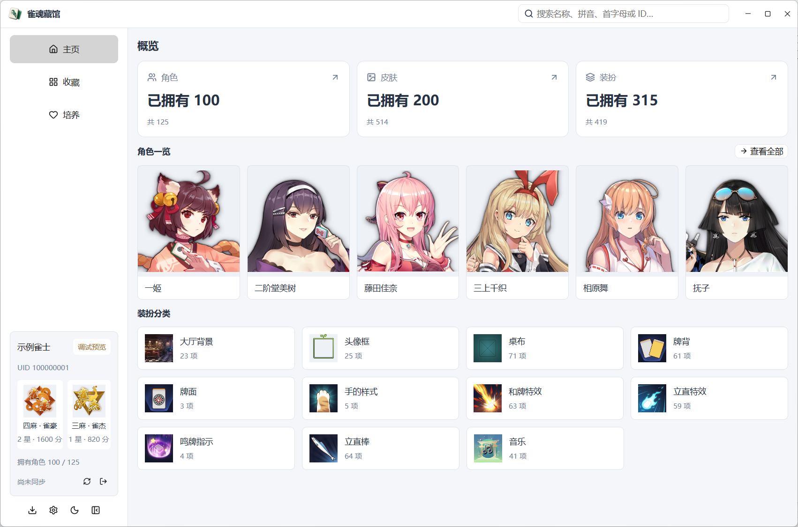
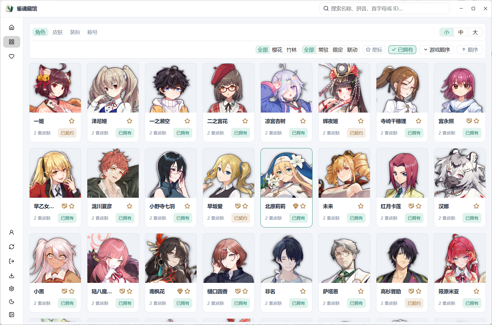
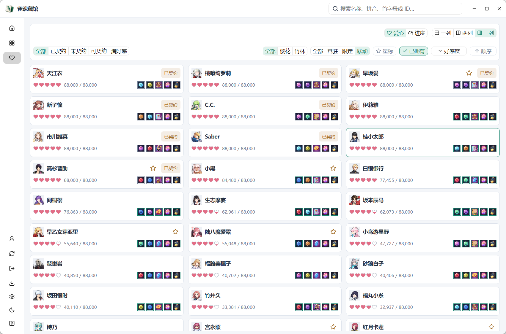
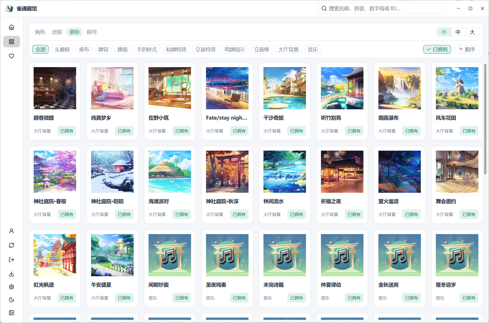
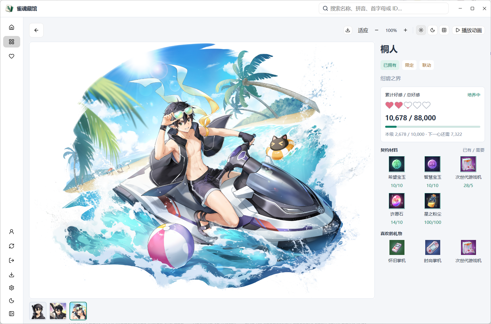
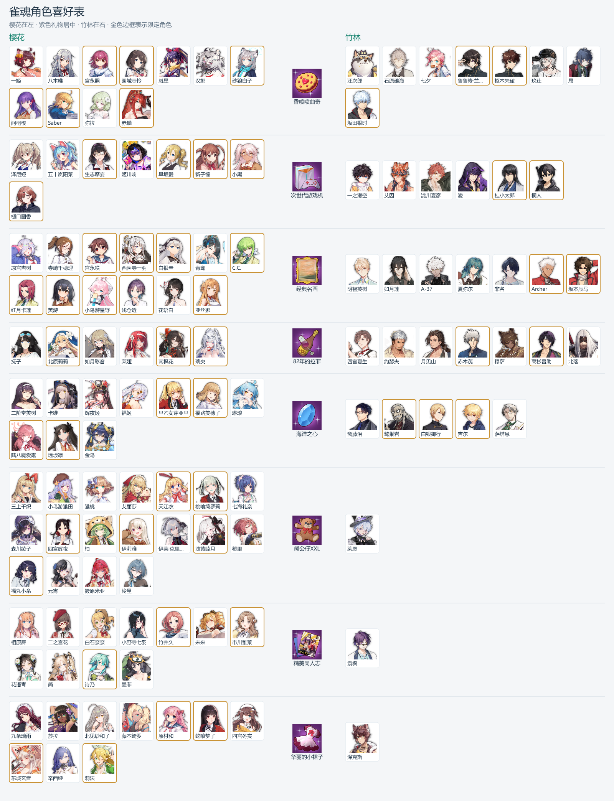

<!-- markdownlint-disable MD033 MD041 -->

<div align="center">
  
  <h1>雀魂藏馆</h1>
  <p><strong>浏览角色与皮肤，整理收藏，规划契约材料。</strong></p>

  <p>
    <a href="https://github.com/ZiyuZ/majsoul-gallery/releases"></a>
    <a href="https://github.com/ZiyuZ/majsoul-gallery/releases"></a>
    
    <a href="Cargo.toml"></a>
  </p>

  <p>
    <a href="https://github.com/ZiyuZ/majsoul-gallery/releases">下载</a> ·
    <a href="https://ziyuz.github.io/majsoul-gallery/gifts/">在线角色喜好表</a> ·
    <a href="#开始使用">开始使用</a> ·
    <a href="#开发">开发</a>
  </p>
</div>

---



雀魂藏馆是一款雀魂角色养成工具。导入本机雀魂素材后，可以离线浏览角色、皮肤和装扮。登录账号后，可以查看已拥有内容、好感进度和契约材料库存。仅支持 Windows。

> [!WARNING]
> 本项目仅供学习与研究使用，与雀魂官方无关联。使用本工具登录或访问游戏服务可能导致账号限制、封禁等后果，请遵守游戏服务条款并自行承担使用风险。作者不对使用本工具造成的损失承担责任。雀魂的游戏素材、商标及相关内容的版权与其他权利归其各自权利人所有。

收藏支持中文、拼音、首字母和 ID 搜索，可按樱花／竹林、常驻／限定／联动筛选。培养页将好感、喜好礼物和契约材料放在一起，方便查找可契约的角色和缺少的材料。支持图片导出功能。

## 界面预览

| 收藏 | 培养 |
| :---: | :---: |
|  |  |
| 装扮 | 角色与皮肤详情 |
|  |  |

## 开始使用

1. 从 <a href="../../releases">Releases</a> 下载 Windows 版本，解压到可写入的文件夹，运行 `majsoul-gallery.exe`。
2. 首次启动会搜索本机 Steam 中的雀魂安装。也可以手动选择雀魂安装目录、游戏程序或 `StandaloneWindows` 资源目录，然后开始导入。
3. 导入完成即可离线浏览。需要查看个人收藏与培养进度时，点击侧栏底部的账号入口登录。

首次导入耗时取决于安装内容与磁盘速度。之后启动可直接使用，并在本地游戏资源更新时增量导入。素材来源和重新导入选项位于设置中。

使用账号与密码登录后，角色、皮肤、装扮、星标、好感与库存会保存在本地，培养页支持按好感度和游戏内角色顺序排列。

> 勾选“记住密码”后，应用会在本地明文保存可用于登录的密码派生值。请将它与密码同等保管。“自动登录”会同时启用记住密码。

## 角色喜好表

按紫色礼物整理角色。HTML 版支持中文、拼音、首字母和 ID 搜索。

**[在线查看角色喜好表](https://ziyuz.github.io/majsoul-gallery/gifts/)** · [下载 HTML](https://github.com/ZiyuZ/majsoul-gallery/raw/refs/heads/main/site/gifts/index.html)

下载后用浏览器打开即可离线使用。

<details>
<summary>查看图片版角色喜好</summary>



</details>

应用侧栏的导出按钮可以生成喜好表和已拥有清单，支持 HTML 与 PNG，并可选择导出范围。

<details>
<summary>命令行导出</summary>

在程序所在目录打开终端：

```shell
# 角色喜好表
.\majsoul-gallery.exe --export-gifts gifts.html
.\majsoul-gallery.exe --export-gifts gifts.png --pool sakura --availability limited

# 最近同步账号的已拥有清单
.\majsoul-gallery.exe --export-owned owned.html --types characters,skins,decorations
```

导出默认使用当前素材库和最近同步的账号。全部参数见 `.\majsoul-gallery.exe --help`。

</details>

## 本地数据

设置、账号数据和素材保存在程序旁的 `majsoul-gallery-data` 文件夹中。备份或迁移时，将它与程序一起复制即可。不同账号的数据分别保存。

选择“重新生成全部素材”会清理并重建当前素材库。导入取消或失败后可以重试。

取消勾选“记住密码”会删除当前账号保存的登录信息。

## 使用限制

可浏览的素材取决于本机雀魂安装中已有的内容，目前尚不支持从网络获取素材。

发布版本以静态立绘展示动态皮肤。需要播放和导出动画时，可按下方说明自行构建支持动态皮肤的版本。部分特效与游戏内的显示效果有差异。

## 开发

安装 Rust（MSVC 工具链）和 Visual Studio Build Tools 的“使用 C++ 的桌面开发”组件。下载本项目源码 ZIP 并解压，或通过 Git 克隆本仓库，然后在项目根目录打开终端：

```shell
cargo run
cargo build --release
```

Release 程序位于 `.local/target/release/majsoul-gallery.exe`。

<details>
<summary>Spine 动态皮肤支持</summary>

构建前，请确认满足 [Spine 许可条件](https://esotericsoftware.com/spine-editor-license)。

在项目根目录执行以下两步：

```shell
# 准备动态皮肤依赖
cargo xtask prepare-spine

# 构建支持动态皮肤的版本
cargo build --release --features spine --config 'patch.crates-io.rusty_spine.path="vendor/rusty-spine"'
```

生成的程序位于 `.local/target/release/majsoul-gallery.exe`。运行后，在设置中执行增量导入以补充动态素材，即可播放动画、切换动作和导出 WebP 动画。

</details>

技术文档：[产品设计](docs/majsoul-gallery-design.md) · [本地资源分析](docs/resources.md) · [素材包格式](docs/asset-export-format.md) · [账号 API](docs/account-api.md)。

## 致谢

界面使用 [GPUI Kit](https://github.com/longbridge/gpui-kit)。账号协议分析参考了 [Akagi](https://github.com/shinkuan/Akagi)、[mahjong_soul_api](https://github.com/MahjongRepository/mahjong_soul_api)、[MajsoulMax](https://github.com/Avenshy/MajsoulMax)、[Naki](https://github.com/Sunalamye/Naki) 和 [majsoul-api](https://github.com/vg-mjg/majsoul-api)，来源与参考范围见[账号 API 文档](docs/account-api.md)。

雀魂游戏素材的版权归其权利人所有。
